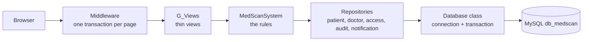
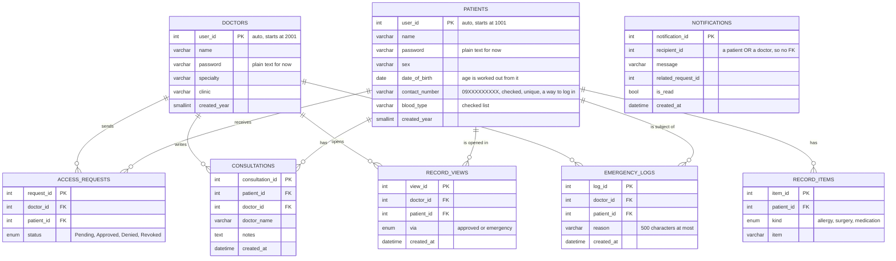
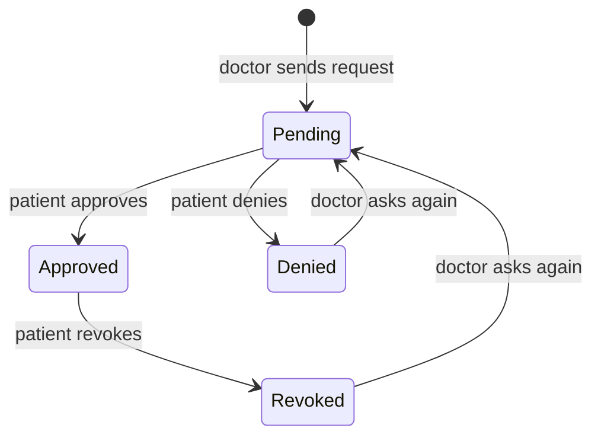
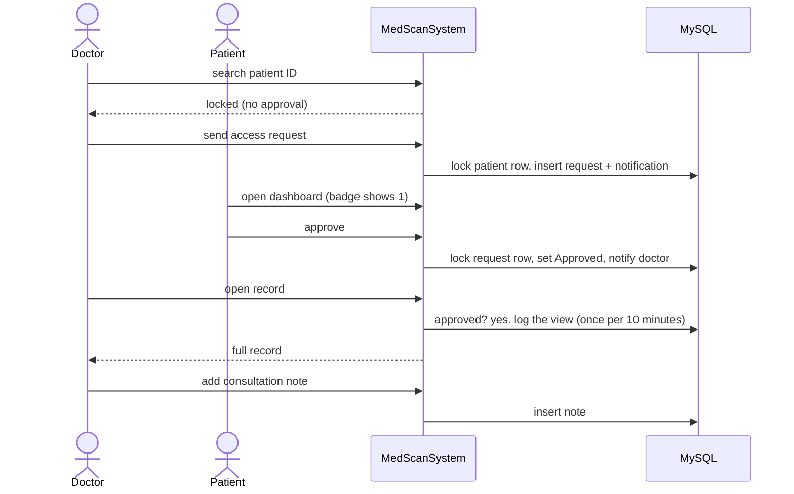
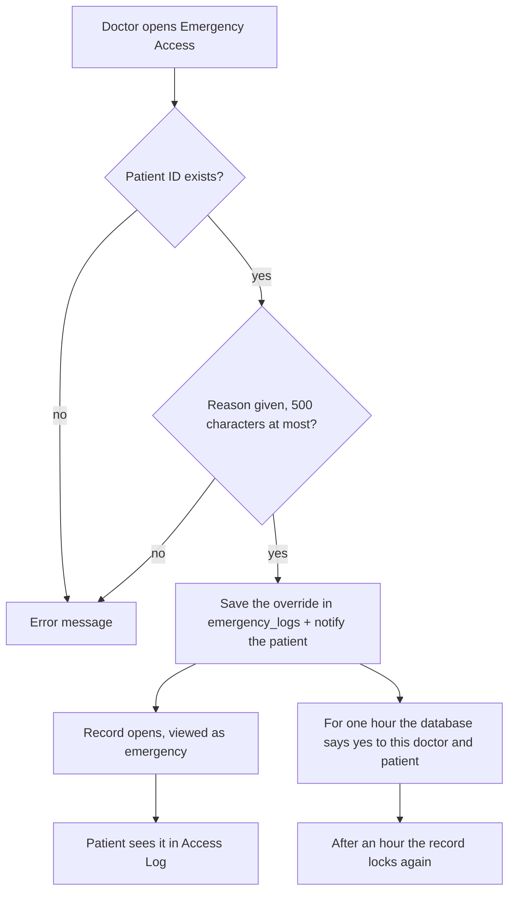
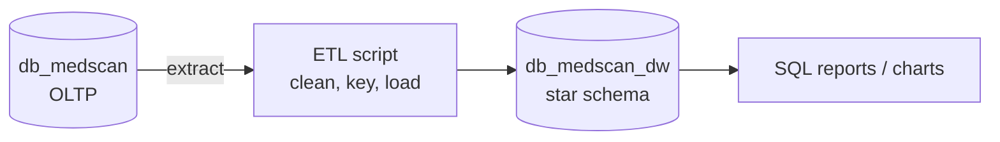
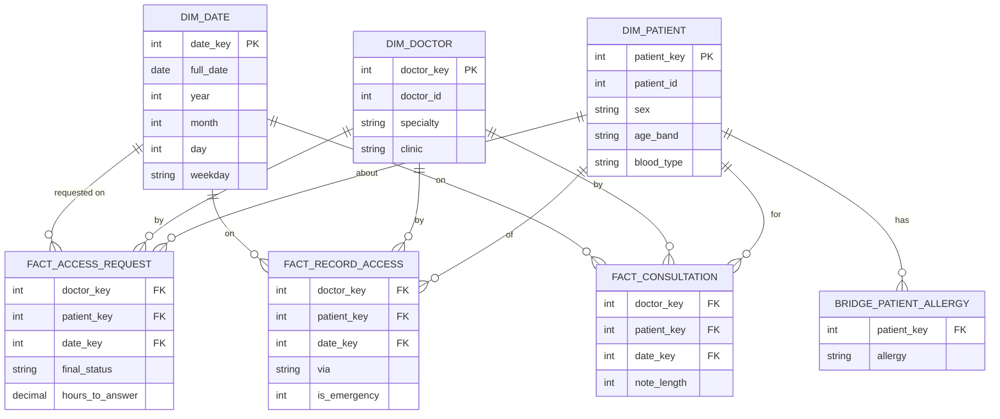

# MedScan: design notes

How the system is built, the database ERD, the flows, the data warehouse plan (on standby) and the bug list.
Diagrams are Mermaid, so they show on GitHub, and in VS Code with the "Markdown Preview Mermaid Support" extension.
phpMyAdmin can draw the ERD too: open `db_medscan`, then **Designer**.

## 1. How data moves



- **MySQL is the only place data lives.** `MedScanSystem` holds the rules and keeps no copy of the data. Each question or
  change is a targeted SQL statement run by a repository (for example `UPDATE access_requests SET status = 'Approved' WHERE request_id = 3`).
- **One transaction per web page.** The middleware opens it, every query of the page shares one connection, and the page is
  saved only if it was built without an error. A page that breaks undoes everything it changed. The connection opens lazily, so a
  page that asks the database nothing (the login form) opens none.
- **Rules that need to be airtight use locks.** Sending or answering a request locks the row involved
  (`SELECT ... FOR UPDATE`), so two clicks at the same moment cannot both win.
- **The database refuses bad data by itself.** Strict mode, foreign keys, `ENUM` columns and `CHECK` constraints stand behind the
  Python checks.
- **The tables and the test accounts are SQL files** (`database/schema.sql`, `database/seed.sql`), not Python.

| Layer | Folder | Job |
|---|---|---|
| GUI | `gui/` (`G_`) | Views, templates, CSS, the per-page transaction |
| Logic | `logic/` (`L_`) | `MedScanSystem`: access rules, checks, what happens on each action |
| Models | `models/` (`M_`) | `User`, `Patient`, `Doctor`, `MedicalRecord`, `Consultation`, `AccessRequest`, ... |
| Data | `data/` (`D_`) | `Database` and one repository class per kind of data |
| SQL | `database/` | `schema.sql`, `seed.sql` |

OOP in this design: **encapsulation** (`User` keeps its password private; `MedScanSystem` is the only door to the rules),
**inheritance** (`Patient` and `Doctor` extend `User`), **polymorphism** (`display_id` is built from each subclass's `ID_PREFIX`;
`current_user()` treats both as a `User`), **abstraction** (`Doctor.add_consultation()` hides building the note, the views call
`system.request_access()` and never see SQL).

## 2. ERD: `db_medscan`



Worth knowing:
- All IDs come from the database (`AUTO_INCREMENT`), so two people registering at once can never get the same ID.
- `NOTIFICATIONS.recipient_id` points at either table, so the database cannot enforce it. Only the application does.
- `ACCESS_REQUESTS` keeps **only the latest status** and has no timestamps. That is fine for the app, but it is the first thing the
  warehouse needs (section 5).
- Consultations keep a copy of the doctor's name: the note keeps the name that signed it.

### Possible schema changes later

| Change | Why |
|---|---|
| Timestamps on access requests (`requested_at`, `answered_at`, `ended_at`) or an append-only `access_events` table | History for audits and for the warehouse ("how long did approval take") |
| `notifications.kind` (request, approved, denied, revoked, emergency) | The panel picks icons by searching the message text, which breaks if the wording changes |
| Password hashing | Plain text passwords should not stay |

## 3. Flows

### 3.1 Life of an access request



Enforced in `MedScanSystem`: one open request per doctor and patient (no duplicates), only the owning patient can answer, only a
Pending request can be answered, only an Approved one can be revoked.

### 3.2 A normal visit



### 3.3 Emergency override



The override is a row in `emergency_logs`, not a flag in the browser session. "Is the emergency still active" is a query:
is there a row for this doctor and patient from the last hour. It cannot be forged, it expires by itself, and it is auditable.

### 3.4 Rules for typed input

| Field | Rule |
|---|---|
| Name | Required, 100 characters at most |
| Password | 6 to 25 characters |
| Date of birth | A real date, not in the future, not more than 120 years ago |
| Mobile number | Required for patients, one account per number. `09171234567`, `+63 917 123 4567` or `63 917 123 4567`; saved as `09XXXXXXXXX`. Doctors have none |
| Blood type | One of A+, A-, B+, B-, AB+, AB-, O+, O- or blank |
| Specialty / clinic | 100 / 150 characters at most |
| Each allergy, surgery, medication | 200 characters at most |
| Consultation note / emergency reason | 5000 / 500 characters at most |

Python checks first and gives a readable message. The database repeats the important ones (mobile format, blood type, choices,
lengths) as a second line of defence.

### 3.5 The pages

Each role has only the pages it needs. Every page has one job, and nothing is shown in two places.

| Role | Page | What is on it |
|---|---|---|
| Patient | Home | Requests waiting for an answer (Approve / Deny), the "Finish your health profile" card while blood type, allergies or medications are empty, then four equal cards: health snapshot, who can open my record, last consultation, recent activity |
| Patient | My Health | Name, ID, mobile number, allergies, medications, surgeries, consultation notes, and the edit form |
| Patient | My QR Code | The patient's own code (a picture with name and ID), a Copy ID button and three steps. Only patients have a code; it holds the ID and nothing else. Placeholder for now: the picture is drawn from the ID and cannot be scanned |
| Patient | Privacy | Tab Doctors (waiting, can open, past; revoke) and tab Who opened my record (views and emergency uses) |
| Doctor | Home | A greeting band with Find a patient and Emergency access, four equal number cards, then four equal panels: ready to open, notes this week (bar chart), recently opened, latest activity |
| Doctor | Patients | The result of a search (two equal buttons: send request, emergency), and three tabs: my patients, waiting for an answer, declined or ended, as a table whose columns line up |
| Both | Sign-up | First two equal tiles (patient, doctor), then a short form for the chosen role. Patient: name, mobile, date of birth, sex, password, and an optional closed section for allergies and surgeries. Doctor: name, password, specialty, clinic |
| Doctor | Scan QR | The scanner (a camera frame) and three steps. Placeholder: the camera is not connected. Scanning will open the same patient result as a search, with the buttons to send a request or use emergency access |
| Doctor | Top bar | Search box (suggestions, press `/`), the red Emergency button (a pop-up), the bell |

Addresses from earlier versions (`/search/`, `/requests/`, `/doctors/`, `/access-log/`, `/profile/`) still work and lead to the page
that replaced them.

Clicks for common jobs:

| Job | Before | Now |
|---|---|---|
| Patient answers a request | bell, notification, My Doctors, Approve (4) | bell, Approve (2) |
| Doctor opens a record after approval | bell, notification, My Requests, Open record (4) | bell, notification, and the record opens (2) |
| Doctor finds a new patient | menu, type, Search, Request (4) | `/`, type, Enter, Request (3) |
| Doctor opens one of their own patients | My Patients, Open (2) | type a few letters, Enter (1 to 2) |
| Emergency access | menu, type, reason, confirm, submit (5) | Emergency, reason, Open record (3) |

### 3.6 The screens help while you type

| Helper | How it works |
|---|---|
| Counters and messages next to fields | `G_Fields.js` counts characters and shows the same rules the server checks (`G_Format.js`) |
| Phone numbers | Always typed and shown as `0917 123 4567`; `+63` and `63` become `09`. Saved as `09171234567` |
| Dates of birth | Typed as `MM/DD/YYYY`, slashes added automatically, with an optional calendar. To switch to day/month, change `DATE_FORMAT` in `MedScanSystem` and the date functions in `G_Format.js` |
| Submit button | Stays grey until the visible fields are valid. The server still checks everything, so a failed script never blocks a valid form |
| Chips | Allergies, surgeries and medications are added and removed one by one; the form still sends the same comma-separated text |
| "Are you sure?" | Any form with `data-confirm` asks first (revoke, deny, emergency access) |
| One click only | Submit buttons lock after the first click |
| Messages | Shown as toasts that fade by themselves; on the login and register pages they stay next to the form |
| Notifications | Each one is a link to the page it is about; "Mark all read" clears the rest |
| Registering | Registering also logs you in and opens the dashboard, which shows an ID card once (with a Copy button) |
| Logging in | The login box takes the ID (`1001`), the full ID (`PT-2026-01001`) or a patient's mobile number, so a forgotten ID is never a locked door |
| Live bell | The page asks `/notifications/poll/` every 10 seconds and updates the bell, the sidebar counts and the panel. It never reloads the page. These background requests do not renew the session, so the idle logout still works in a tab that is only asking |
| Bell panel | Approve and Deny buttons sit on each waiting request, so a patient can answer without leaving the page |
| Search box | Suggestions from the doctor's own patients only (name or ID); `/` jumps to the box; while the box has the focus everything else is dimmed and blurred and only the box stays sharp |
| Profile card | Patient Home shows how much of the profile is filled in (`profile_progress`) until it is complete, or until the patient hides it (remembered in the browser only) |
| Quick phrases | Buttons above the note box add a ready sentence to the note |
| Emergency | A pop-up from the top bar or a search result; the page version remains for browsers without scripts |
| Times | "5 min ago", with the exact time shown when you hover |
| Login | An optional "Remember me" (only the ID is remembered, never the password). The boxes start empty with no hints; a red message appears only after Log in is pressed with a box empty |
| Idle logout | 15 minutes without activity (`IDLE_LOGOUT_MINUTES` in `settings.py`). A warning shows a minute before, and the page pings the server while you are active so a long note is never lost |

All scripts are plain old-style JavaScript with no libraries and nothing loaded from the internet.

## 4. Tests

`python -m unittest` runs about 310 tests against their own database, `db_medscan_test`. Most tests run inside a transaction that is rolled
back afterwards, so they are fast and cannot affect each other. A smaller group uses real commits to prove the saving itself:
a second system reads back what the first saved, failed pages save nothing, simultaneous requests make one request, the database
is created when missing, and a page uses one connection.

## 5. Data warehouse plan (on standby)

Not started. Kept here so the idea is not lost. Keep `db_medscan` as the **OLTP source** and add a second database,
**`db_medscan_dw`**, shaped for questions instead of transactions. A small Python script copies and reshapes the data.





- **Facts are events** (a request, a record opened, a note written). **Dimensions say who and when.**
- **No personal data** in the warehouse: no names, passwords or contact numbers.
- Age bands come from `date_of_birth` (0-17, 18-39, 40-59, 60+), which is why the date of birth replaced age.
- `hours_to_answer` needs timestamps on access requests (section 2), the one schema change this needs first.

Example questions it would answer:

```sql
-- Emergency overrides per clinic per month
SELECT d.clinic, t.year, t.month, COUNT(*) AS overrides
FROM fact_record_access f
JOIN dim_doctor d ON d.doctor_key = f.doctor_key
JOIN dim_date   t ON t.date_key   = f.date_key
WHERE f.is_emergency = 1
GROUP BY d.clinic, t.year, t.month;

-- How fast do patients answer, by doctor specialty
SELECT d.specialty, ROUND(AVG(f.hours_to_answer), 1) AS avg_hours
FROM fact_access_request f
JOIN dim_doctor d ON d.doctor_key = f.doctor_key
WHERE f.final_status <> 'Pending'
GROUP BY d.specialty;
```

## 6. Bugs and risks

| # | Item | Status |
|---|---|---|
| 1 | Over-long names, notes or reasons broke the MySQL save | **Fixed**: limits match the columns; strict mode makes MySQL refuse instead of cutting text |
| 2 | Contact number had no real format | **Fixed**: Philippine mobile formats, saved as `09XXXXXXXXX`, also checked by the database |
| 3 | The app quietly switched to a pickle file when MySQL was off, splitting the data | **Fixed**: pickle removed; MySQL is required and the error says "Connection error" |
| 4 | A wrong icon name crashed a page | **Fixed**: draws an empty icon, and a test catches typos |
| 5 | Editing info could half-apply | **Fixed**: everything is checked before anything is changed |
| 6 | Emergency access never expired | **Fixed**: lasts one hour, stored in the database |
| 7 | Whole-system save: two requests at once could overwrite each other | **Fixed**: targeted statements, row locks, tests with 8 simultaneous requests |
| 8 | Reads came from memory, so outside edits in MySQL were invisible | **Fixed**: no copy in memory; every page reads MySQL |
| 9 | Age was stored and went stale | **Fixed**: date of birth, age worked out |
| 10 | No password length rules | **Fixed**: 6 to 25 characters |
| 11 | Plain text passwords | Open (known) |
| 12 | No limit on wrong passwords | Open: lock for a few minutes after 5 tries |
| 13 | Notification icons depend on message wording | Open ("depends": a `kind` column would fix it) |
| 14 | Access requests have no timestamps or history | Open (needed only for the warehouse) |
| 15 | A comment in the notification template showed up as text in the bell panel | **Fixed**: it spanned two lines, which Django does not treat as a comment |

## 7. Still undecided

1. **Data warehouse**: standby.
2. **Notification `kind`**: depends.
3. **Password hashing**: later, before any real use.
